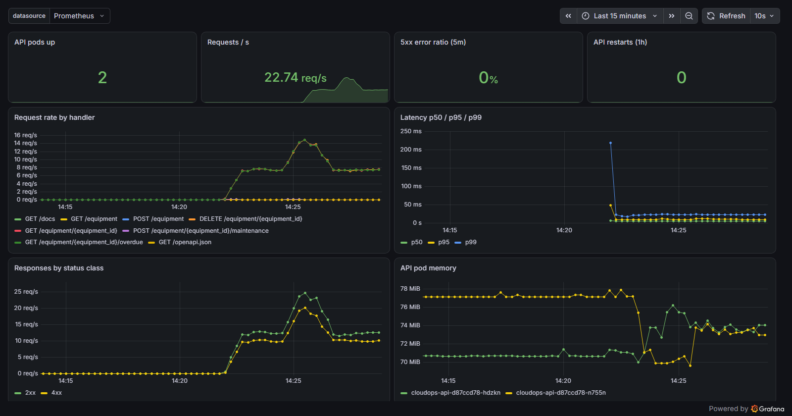
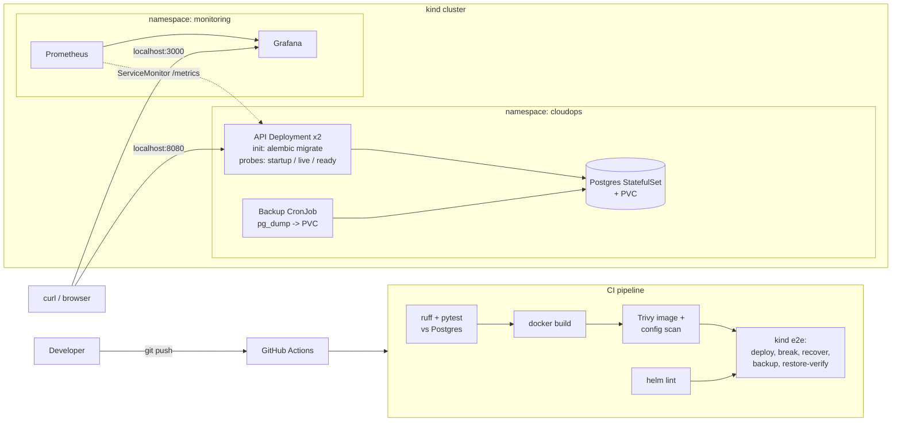

# CloudOps Launchpad — Cloud Engineering & DevOps Lab

A local, fully reproducible cloud-ops lab: an **equipment-maintenance API** (FastAPI + PostgreSQL)
packaged with **Docker**, deployed to **Kubernetes (kind)** with **Helm**, tested and security-scanned
in **GitHub Actions**, and observed with **Prometheus + Grafana** — plus scripted, CI-verified
**failed-deployment recovery** and **backup → restore → verify** drills.


**📸 [Screenshots: Grafana, CI pipeline, security scans, recovery and backup drills →](portfolio/README.md)**



## Architecture



## Stack

| Area | Choice | Notes |
|---|---|---|
| API | FastAPI, SQLAlchemy 2, Alembic | `/healthz` (liveness), `/readyz` (DB check), `/metrics` |
| Database | PostgreSQL 17 StatefulSet | Hand-written (no third-party chart), non-root, read-only rootfs |
| Container | Multi-stage `python:3.12-slim` | Non-root UID 10001, no pip in runtime image, HEALTHCHECK |
| Orchestration | kind + Helm 4 | `--rollback-on-failure`, `maxUnavailable: 0`, PDB, resource limits |
| Migrations | Init container + Postgres advisory lock | Replicas can't race; a bad release fails *before* serving |
| Monitoring | kube-prometheus-stack | ServiceMonitor, 3 alert rules, auto-provisioned Grafana dashboard |
| CI | GitHub Actions | Lint → test → build → Trivy → kind e2e with ops drills |

## Quick start

Prerequisites (Windows, via winget): Docker Desktop, Git, Python 3.11+, plus
`winget install Kubernetes.kind Helm.Helm GitHub.cli AquaSecurity.Trivy`.
Run scripts from **Git Bash** (they also run unchanged on Linux/macOS and in CI).

```bash
scripts/cluster-up.sh        # kind cluster + Prometheus/Grafana (~5 min first time)
scripts/deploy.sh            # build image, load into kind, helm upgrade, smoke test
scripts/seed-and-load.sh     # demo data + 60 s of traffic for the dashboard
```

| URL | What |
|---|---|
| http://localhost:8080/docs | API (Swagger UI) |
| http://localhost:3000 | Grafana — `admin` / `cloudops`, dashboard **CloudOps Launchpad API** |
| http://localhost:9090 | Prometheus (Status → Targets shows `cloudops-api` UP) |

Fast inner loop without Kubernetes:

```bash
docker compose up --build             # API on http://localhost:8000
python -m venv .venv && .venv/Scripts/pip install -r requirements-dev.txt
docker compose up -d db && .venv/Scripts/pytest
```

## API

| Method | Path | Purpose |
|---|---|---|
| GET/POST | `/equipment` | List (`?status_filter=`) / create equipment |
| GET/PATCH/DELETE | `/equipment/{id}` | Read / update / delete |
| GET/POST | `/equipment/{id}/maintenance` | Maintenance history / log a service |
| GET | `/equipment/{id}/overdue` | Is the latest `next_due` date in the past? |
| GET | `/healthz`, `/readyz`, `/metrics` | Liveness, readiness, Prometheus metrics |

## Runbooks

### Failed deployment → recovery

```bash
scripts/break-deploy.sh   # deploys a non-existent image tag; release is left "failed"
scripts/recover.sh        # detects it, rolls back to the last good revision, smoke-tests
```

`recover.sh` treats the release as unhealthy if Helm status isn't `deployed`, the Deployment
hasn't finished rolling out, or `/readyz` fails. It prints pod failure reasons, picks the newest
earlier revision that actually deployed, runs `helm rollback`, and re-runs the smoke test.
Because the rollout uses `maxUnavailable: 0`, the old pods keep serving during the bad rollout,
so users see no downtime. Normal deploys via `deploy.sh` use `--rollback-on-failure` and
undo themselves.

### Backup → restore → verify

```bash
scripts/backup.sh               # pg_dump -Fc -> backups/cloudops-<UTC>.dump + .manifest
scripts/restore-verify.sh       # restore newest dump into a scratch DB and compare
scripts/backup.sh --in-cluster  # run the nightly CronJob now (dump lands on a PVC)
```

`backup.sh` records a **manifest**: row counts and an md5 over every row of every table.
`restore-verify.sh` restores the dump into a throwaway `verify_restore` database, recomputes
the same checksums, and prints `PASS` only if every table matches. Then it drops the scratch
DB. A backup you haven't restored is only a hope.
(The manifest is taken just before `pg_dump`, so verify against a quiet database.)

### Alerts

| Alert | Fires when |
|---|---|
| `CloudOpsApiDown` | No API target is being scraped for 1 min |
| `CloudOpsHighErrorRate` | 5xx ratio > 5 % for 5 min |
| `CloudOpsPodRestarting` | An API container restarts > 2× in 15 min |

## Repository layout

```
app/                    FastAPI service + Alembic migrations
tests/                  pytest suite (runs against real Postgres)
deploy/kind-config.yaml kind cluster with host port mappings
deploy/helm/cloudops/   Helm chart (API, Postgres, backups, monitoring, dashboard)
deploy/monitoring/      kube-prometheus-stack values
scripts/                cluster, deploy, smoke, recover, backup, restore-verify
.github/workflows/      CI pipeline
```

## Teardown

```bash
scripts/cluster-down.sh   # deletes the cluster; ./backups is kept
docker compose down -v
```
