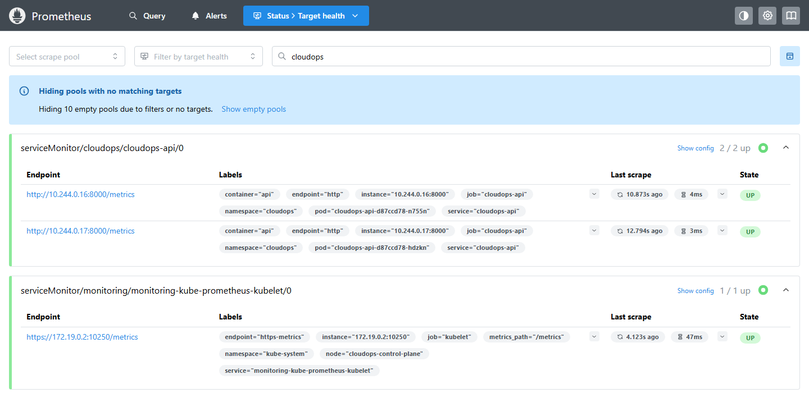
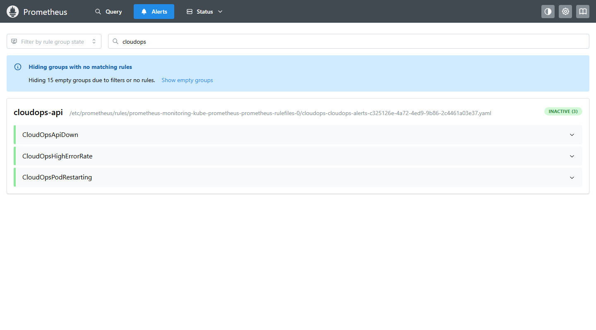
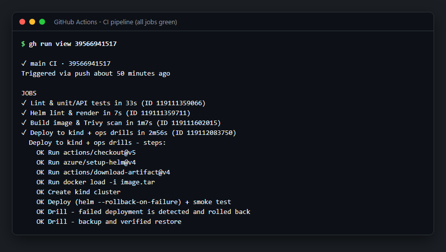
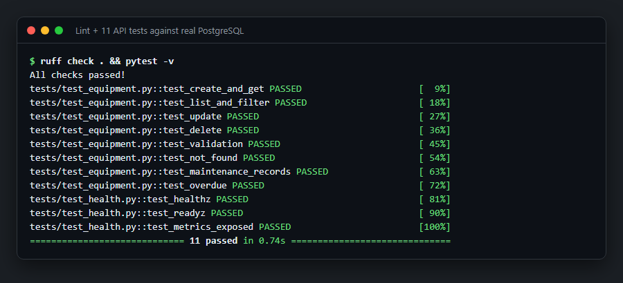
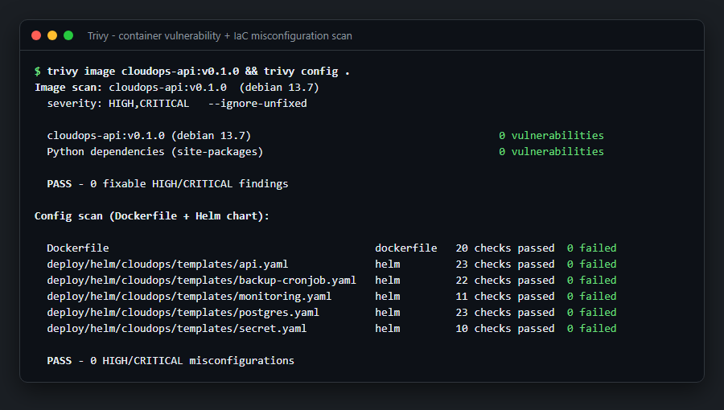
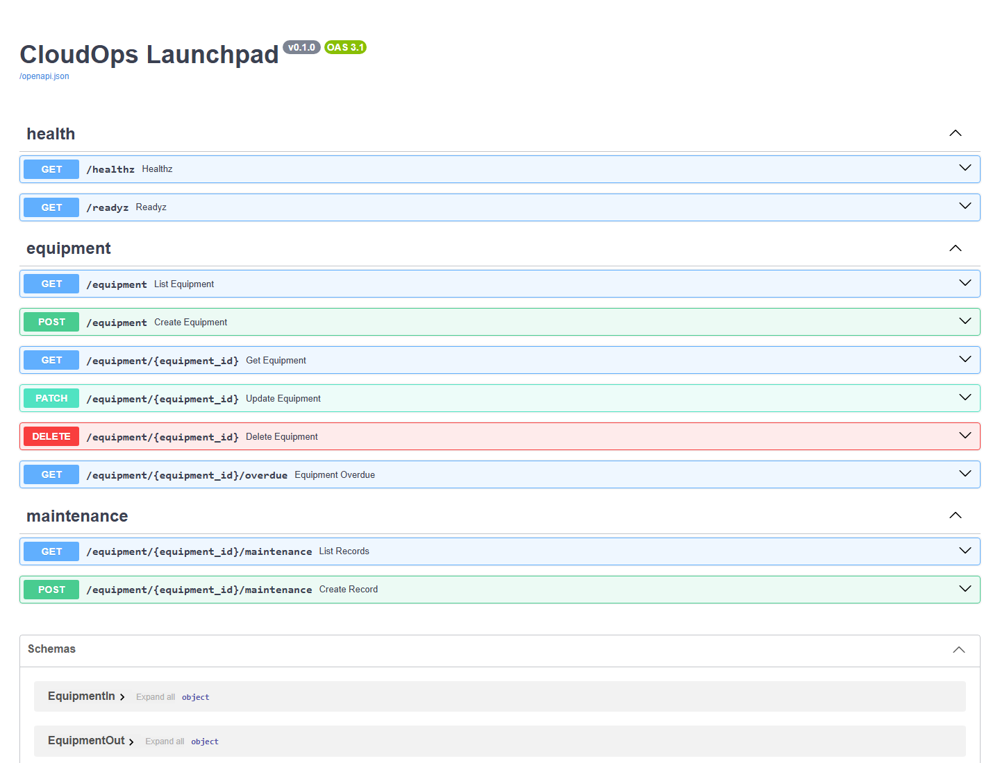
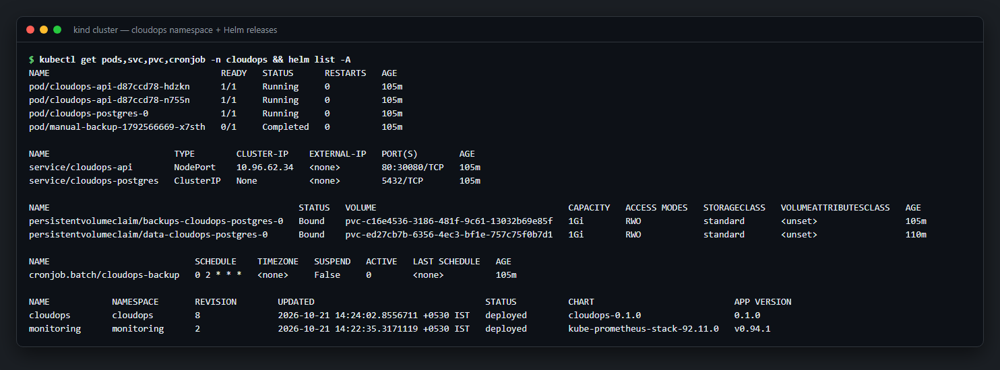
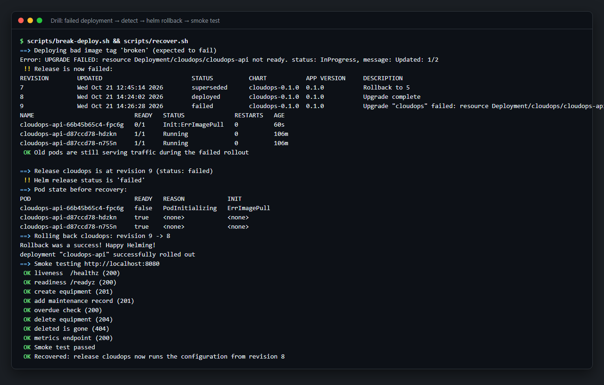
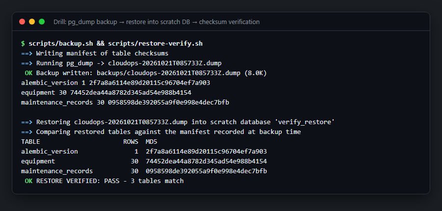
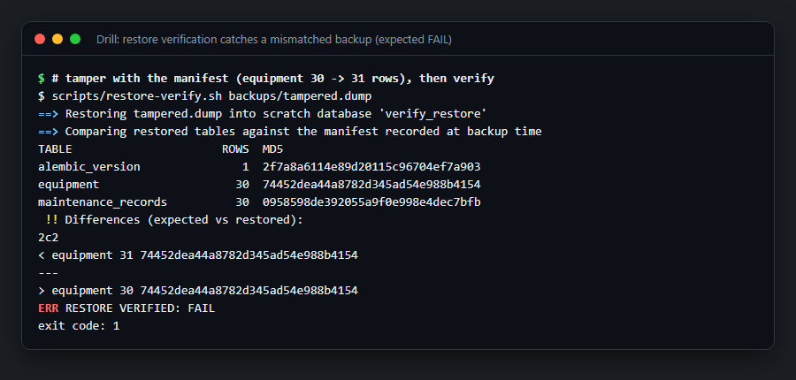

# CloudOps Launchpad — Portfolio Screenshots

Every screenshot below was captured from the running lab: a local kind cluster, the live
Prometheus/Grafana stack, and the real GitHub Actions run. Terminal screenshots are the actual
script output, rendered as a terminal window.

## Observability

### 1. Grafana dashboard
Request rate by handler, p50/p95/p99 latency, responses by status class, 5xx error ratio, pod
memory, and restarts. The dashboard is provisioned automatically from the Helm chart
(a ConfigMap picked up by the Grafana sidecar).

### 5. Prometheus scrape targets
The ServiceMonitor in the chart makes Prometheus discover both API pods automatically.

### 6. Alert rules
A PrometheusRule shipped in the chart: API down, 5xx ratio above 5 %, and restart loops.

## CI/CD and security

### 2. GitHub Actions pipeline
Lint → tests against Postgres → image build → Trivy scan → deploy to an ephemeral kind cluster
→ automated recovery and backup drills. Runs on every push.

### 7. Tests and lint
11 API tests that run against a real PostgreSQL database (not mocks), after Alembic migrations.

### 8. Trivy security scans
The container image has 0 fixable HIGH/CRITICAL CVEs, and the Dockerfile and every Helm template
pass the misconfiguration checks: non-root, read-only root filesystem, dropped capabilities,
and seccomp. The first scan caught a vulnerable Starlette version; the fix was to upgrade and
pin it.

## Platform

### 3. API (FastAPI / OpenAPI)

### 4. Kubernetes resources
Two API replicas, a Postgres StatefulSet with persistent volumes for data and backups, the
nightly backup CronJob, and both Helm releases.

## Operational drills

### 9. Failed deployment → automatic detection → rollback
A release with a non-existent image fails. The old pods keep serving traffic throughout
(`maxUnavailable: 0`). `recover.sh` detects the failed release, shows why the pods are
unhealthy, rolls back to the last good revision, and smoke-tests the result.

### 10. Backup → restore → verify
`pg_dump` plus a manifest of per-table row counts and md5 checksums. The dump is restored into
a scratch database and verified to match exactly.

### 11. Verification catches a bad backup
Negative test: the manifest is altered, and verification fails with exit code 1. The check can
actually fail, so a PASS means something.

